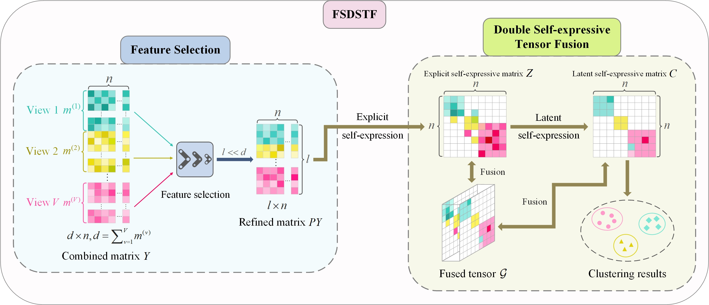

 

|                                                                                                                                                                                                                                                                                                                                                                                                                                                                                                                                                                                                                                                                               |
| :-------------------------------------------------------------------------------------------------------------------------------------------------------------------------------------------------------------------------------------------------------------------------------------------------------------------------------------------------------------------------------------------------------------------------------------------------------------------------------------------------------------------------------------------------------------------------------------------------------------------------------------------------------------------------------------------------------------------- |

 

cite:

@article{zheng2026feature,
  title={Feature selection and double self-expressive tensor fusion for multi-view subspace clustering},
  author={Zheng, Tianqi and Li, Xiangcheng and Sun, Youming and Guo, Jipeng and Yang, Tianchuan and Chen, Haiqiang},
  journal={Information Sciences},
  pages={123534},
  year={2026},
  publisher={Elsevier}
}

Run "run_demo.m" to test the algorithm. The code has been tested in Matlab R2021b on a PC with Windows 10.
